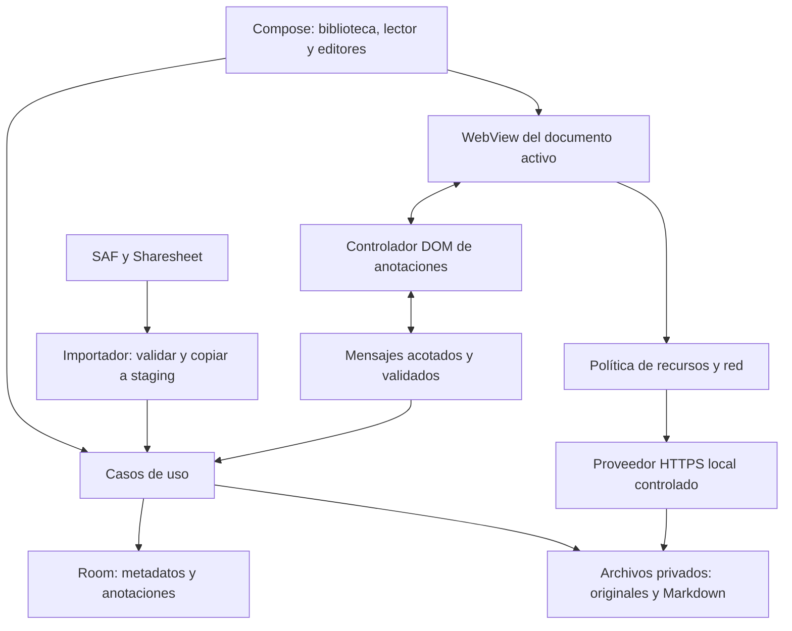

# Arquitectura de Hyper-Marker

Estado: diseño de arranque, sin implementación. Basado en las secciones 5–7 de la [especificación](Interactive_Notes_Android_Agent_Design.md). Las decisiones marcadas **propuesta** se validan en el hito correspondiente y se registran en `progress.md`.

## 1. Límites y responsabilidades

Android nativo con Kotlin, Compose, Room y WebView. Se propone un único módulo Gradle `app` con paquetes por responsabilidad; los nombres siguientes describen responsabilidades, no archivos existentes:

```text
app/src/main/java/<namespace>/
  library/       Biblioteca, búsqueda, navegación, acciones e importación
  viewer/        Host WebView, historial, consola, autoscroll, lifecycle
  markdown/      Source/Visual, conversión, autosave, historial de edición
  annotation/    Pines, anclas, trazos, comandos undo/redo, herramientas
  storage/       Room, repositorios, archivos privados, staging de importación
  security/      Rutas, origen, política de red, permisos y validación
  bridge/        Contratos, validación y transporte de mensajes
app/src/main/assets/annotation/   Controlador JS/CSS de confianza de la app
```

La UI invoca casos de uso; éstos coordinan repositorios y políticas. Los repositorios separan metadatos Room de archivos. El controlador DOM comunica objetivos y geometría; Android decide qué datos persistir y qué acciones están permitidas. Los imports y la E/S no bloquean el hilo principal.



## 2. Datos y autoridad

Identidades opacas independientes del nombre del archivo; timestamps consistentes; migraciones explícitas de Room y versiones en payloads. La duplicación crea identidades nuevas y copia también los datos asociados sin compartir archivos mutables.

| Entidad | Campos principales | Invariantes |
| --- | --- | --- |
| Folder | id, parentFolderId?, name, sortOrder, createdAt, updatedAt | Sin ciclos; no mover a sí misma ni a descendientes. Raíz representada por padre nulo. |
| Document | id, folderId?, type, title, entryPath?, rootKey?, trustPolicy, revision, createdAt, updatedAt | HTML requiere entrada válida dentro de su raíz. MARKDOWN tiene fuente privada. Nombre no es identidad. |
| MarkdownContent | documentId, sourcePath, revision, updatedAt | Propuesta: archivo `.md` autoritativo; Room almacena referencia y revisión, no una segunda copia editable del texto. |
| Annotation | id, documentId, kind, schemaVersion, payloadJson, createdAt, updatedAt | PIN o STROKE; datos validados y separados del HTML. |
| Anchor | id, annotationId, pageKey, strategy, selector?, fingerprint?, relativeX, relativeY, fallbackX?, fallbackY?, status | DOM, SURFACE o PAGE; pertenencia a documento/revisión y página. Estado explícito RESOLVED o UNANCHORED. |
| ViewerPreference | documentId, zoom?, scrollSpeed?, scrollDirection?, lastPosition? | Preferencias por documento; sin autoscroll inesperado al volver a abrir. |

El `pageKey` es una extensión propuesta para impedir mostrar anotaciones de una página en otra del mismo proyecto. Debe identificar la ruta interna normalizada; hash/ruta SPA requiere una política verificable en H5. No incluir parámetros o fragmentos a ciegas si sólo representan navegación al mismo contenido.

El payload PIN contiene título y cuerpo Markdown. El payload STROKE contiene herramienta, color, ancho, puntos y sistema de coordenadas con metadatos de escala/superficie. Los tamaños tienen límites. Una relación opcional entre documentos Markdown y HTML puede añadirse sin acoplar sus archivos.

## 3. Archivos y transacciones

Layout propuesto dentro de `filesDir`:

```text
documents/<documentId>/original/<rutas importadas>
documents/<documentId>/markdown/source.md
imports/<operationId>/staging/
```

`original/` permanece inmutable. `rootKey` es una clave controlada por la app, no una ruta proporcionada por el HTML. El controlador JS de la app se distribuye con el APK y se inyecta en ejecución; no se añade a los originales. Al principio los trazos pueden residir en payloads Room; separar blobs a archivos sólo si sus tamaños lo justifican.

Importar mediante una máquina de estados: copiar a staging → validar recursos y límites → resolver entrada → mover al destino privado → confirmar metadatos → publicar en biblioteca. Room y archivos no comparten una transacción: usar un registro de operación o reconciliación equivalente, compensación ante fallo y limpieza recuperable de staging/directorios huérfanos al iniciar. Nunca mostrar un documento parcial como listo.

Markdown se guarda mediante archivo temporal y reemplazo atómico, coordinando su revisión con Room y recuperando discrepancias tras interrupción. Serializar guardados para que una revisión antigua no sobrescriba otra reciente. Definir y probar la ventana de autosave, el guardado al salir y la recuperación tras cierre abrupto; no prometer preservar pulsaciones aún no guardadas.

Eliminación V1: confirmación con alcance visible para carpetas y descendientes; propuesta de operación recuperable hasta terminar la limpieza. Papelera no es obligatoria si existe confirmación. Duplicar/mover debe mantener consistencia ante fallo y evitar ciclos o referencias rotas. Reimportar no implica trasladar anclas automáticamente a una nueva estructura DOM.

## 4. Importación y entrada HTML

Aceptar HTML/HTM, árboles SAF y ZIP; recibir URIs de `ACTION_SEND`/`ACTION_SEND_MULTIPLE` cuando corresponda. No confiar únicamente en extensión/MIME ni conservar dependencia de un permiso temporal. Copiar por streams con límites, cancelar y limpiar sin publicar resultados incompletos.

Preferir `index.html` en la raíz seleccionada. Si sólo hay un directorio envolvente, se propone usarlo como raíz cuando no haya ambigüedad. Si existen múltiples candidatos sin entrada inequívoca, mostrar selector. Mantener rutas relativas y errores de recursos faltantes; un archivo HTML suelto no aporta automáticamente sus recursos vecinos.

Los límites propuestos y amenazas de extracción están en [security.md](docs/security.md). Los valores se prueban y ajustan antes de considerar H2 completo.

## 5. WebView y aislamiento

Servir recursos locales mediante `WebViewAssetLoader` o equivalente HTTPS controlado, con `PathHandler` privado y acceso al documento activo exclusivamente. **Propuesta a validar:** host virtual distinto por documento para reducir colisiones de cookies/storage/orígenes. Un prefijo de ruta por sí solo no aísla orígenes web. Si la API elegida o el perfil WebView impide la separación esperada, registrar la limitación y probar una alternativa antes de entregar H3.

JavaScript se habilita en el lector del documento. Archivo local, acceso universal desde `file://`, interfaces generales de Android, permisos automáticos, ventanas emergentes y navegación no autorizada permanecen deshabilitados. Los detalles de red, subframes, WebSockets, workers y canales que no cubra la intercepción ordinaria son un criterio de implementación y prueba, no una garantía asumida. Véase [security.md](docs/security.md).

Las navegaciones internas conservan el documento y sus límites. URLs externas se tratan mediante una acción explícita y una política de esquema; permitir red no equivale a permitir acceso a otros documentos o lanzar aplicaciones. Antes de salir con Back, usar el historial web. Forward, reload, zoom, fullscreen y consola aparecen bajo demanda.

Capturar consola con `WebChromeClient.onConsoleMessage`; errores globales y de recursos mediante mecanismos acotados cuando sean observables. Limitar buffers; no prometer cobertura completa de errores remotos. Autoscroll con play/pause, velocidad y dirección; toque manual, cambio de modo o salida del lector lo pausa.

Gestionar lifecycle: liberar WebView/observadores al salir, pausar timers cuando corresponda, conservar datos persistidos fuera del renderer, recuperar tras caída del proceso de renderizado y restaurar documento/posición sin duplicar controladores o eventos.

## 6. Protocolo del controlador de anotaciones

Contrato **propuesto v1**, a implementar y probar en H5. Preferir mensajería de AndroidX WebKit con restricciones de origen y frame sobre interfaces JavaScript generales; fijar la API y compatibilidad exactas en H1/H5. No incorporar un fallback inseguro para SDK antiguos.

Sobre común:

```json
{
  "protocolVersion": 1,
  "sessionId": "opaque-viewer-session",
  "documentId": "opaque-document-id",
  "revision": 1,
  "requestId": "unique-request-id",
  "type": "target.selected",
  "payload": {}
}
```

| Dirección | Tipo | Efecto permitido |
| --- | --- | --- |
| Android → controlador | `session.init`, `mode.set` | Inicializar revisión, herramientas y modo autorizado. |
| Android → controlador | `annotations.replace` | Dibujar estado ya validado y persistido. |
| Android → controlador | `anchor.inspect`, `anchor.reanchor`, `gesture.cancel` | Iniciar inspección/reanclaje o cancelar gesto. |
| Controlador → Android | `controller.ready` | Confirmar versión/capacidades. |
| Controlador → Android | `target.selected` | Proponer ancla y posición; Android abre editor, sin guardar aún. |
| Controlador → Android | `anchor.geometry`, `anchor.unresolved` | Informar geometría/estado, sin acceso a archivos. |
| Controlador → Android | `stroke.completed` | Proponer trazo terminado sólo en Draw. |
| Controlador → Android | `annotation.activated` | Solicitar apertura de una anotación del documento activo. |
| Ambas | `protocol.error` | Código acotado, sin stack sensible ni ejecución de código. |

Validar versión, tipo, límites de tamaño, pertenencia, sesión/revisión activa, estado del modo, frame/origen, coordenadas finitas y campos permitidos. Rechazar mensajes repetidos o tardíos tras navegación, recarga, cierre o rotación. Errores de protocolo no deben cerrar la biblioteca. Validar selectors como datos; nunca concatenar texto en código ejecutable. El cuerpo de una nota se transporta como datos serializados y se renderiza con escape/sanitización.

**El JS importado puede compartir el contexto con el controlador.** Un `sessionId` evita confusiones de sesión, pero no autentica de forma secreta al controlador frente a esa página. Tratar incluso mensajes del origen esperado como no confiables; autorizar efectos mínimos ligados al modo nativo, mostrar el editor antes de guardar pines y limitar frecuencia/tamaño. El bridge no permite leer rutas, ejecutar código nativo, modificar otros documentos ni conceder red. Documentar manipulación o interferencia visual residual de páginas hostiles.

## 7. Gesto Pin y resolución de anclas

Estados: View → Pin listo → pulsación pendiente → selección activa → editor → Pin listo. Usar aproximadamente 500 ms ajustables a accesibilidad. Antes de activar, desplazamiento significativo o multitouch cancelan la selección pendiente y respetan scroll/zoom. Una vez activa, el movimiento actualiza objetivo/resaltado en vivo. `pointercancel`, salida de modo o pérdida del documento elimina resaltado y estado temporal.

En Pin, consultar `document.elementsFromPoint(clientX, clientY)`, omitir capas propias y wrappers no útiles, y elegir contenido visible con la frontera que se muestra al usuario. Resaltar con relleno translúcido y contorno por overlay, sin modificar estilos permanentes ni desplazar layout. Al soltar se retira el resaltado y se abre editor; sólo guardar contenido significativo crea un pin. Taps cortos seleccionan pines existentes y no activan controles HTML subyacentes. View restaura gestos normales; los marcadores visibles reciben únicamente su interacción explícita y ninguna capa transparente bloquea la página.

Capturar selector estable cuando exista, huella (tag, texto contextual acotado, ancestros), página, revisión y posición normalizada dentro del rectángulo del objetivo. La huella es una comprobación de identidad; un selector que ahora apunta a otro elemento no autoriza reanclaje silencioso. En V1, resolver coincidencias únicas y defendibles; ante ambigüedad o ausencia marcar UNANCHORED y ofrecer reanclaje manual. Reconciliación difusa avanzada queda para V1.1.

Recalcular con scroll, resize, zoom, rotación y observaciones DOM agrupadas; distinguir CSS pixels, viewport visual y escala nativa. Probar transformaciones y regiones grandes, mostrando límites de precisión. Canvas/WebGL y SVG sin hijos significativos se tratan como superficie con posición relativa; no como objetos semánticos internos. Iframes de origen cruzado pueden no permitir inspección interna: explicitar el límite y usar la superficie del frame cuando sea verificable.

## 8. Dibujos, Markdown y UX

Dibujos: overlay SVG o equivalente, coordenadas de documento o superficie explícita, metadatos de viewport/zoom y operaciones completas de undo/redo. Persistir al finalizar cada trazo/transacción. Reabrir restaura estado persistido; se propone historial undo/redo sólo durante la sesión, salvo que pruebas/requisitos posteriores indiquen otra cosa. Clear exige confirmación. Documentar que un trazo de página puede desalinearse si el contenido cambia o refluye.

Markdown: elegir editor mantenible con licencia documentada, edición real Source/Visual y representación compatible. Crear corpus de round-trip antes de decidir la librería. Si un constructo no puede preservarse, advertir, conservar el original y permitir seguir en Source; una vista previa por sí sola no cumple Visual. Sanitizar contenido renderizado y usar contexto controlado separado de documentos importados.

UI: biblioteca con breadcrumb, búsqueda y acciones; lector sin barra permanente, handle discreto y bottom sheet; herramientas mínimas en Pin/Draw; etiquetas TalkBack, objetivos táctiles suficientes, tipografía escalable y alternativa accesible sin long-press. Mantener navegación del sistema funcional.

## 9. Decisiones y preguntas abiertas

| ID | Estado | Decisión / acción | Resolver en |
| --- | --- | --- | --- |
| A01 | Derivada de especificación | Kotlin/Compose, Room, archivos privados y WebView controlado. | H1–H3 |
| A02 | Propuesta | Un módulo `app` con paquetes por función. | H1 |
| A03 | Propuesta | Markdown fuente en `.md`; Room guarda referencia/revisión. | H1/H4 |
| A04 | Propuesta | Host local por documento; validar aislamiento efectivo de storage y red. | H2/H3 |
| A05 | Pendiente | SDK mínimo, toolchain, namespace/applicationId y versiones fijadas. | H1 |
| A06 | Pendiente | Librería Markdown, round-trip y licencias. | H4, exploración en H1 |
| A07 | Propuesta | Protocolo v1, frame principal, mensajes mínimos y validación nativa. | H5 |
| A08 | Propuesta | Historial undo/redo de sesión; estado final durable. | H4–H6 |
| A09 | Pendiente | Identidad de páginas/rutas SPA y política de restauración web. | H3/H5 |
| A10 | Pendiente | Licencia del proyecto y nombre visible de producto. | Antes de distribuir |

Registrar fecha, motivo, alternativas relevantes y evidencia al confirmar o cambiar decisiones. Ninguna fila pendiente implica permiso para omitir un requisito V1.
