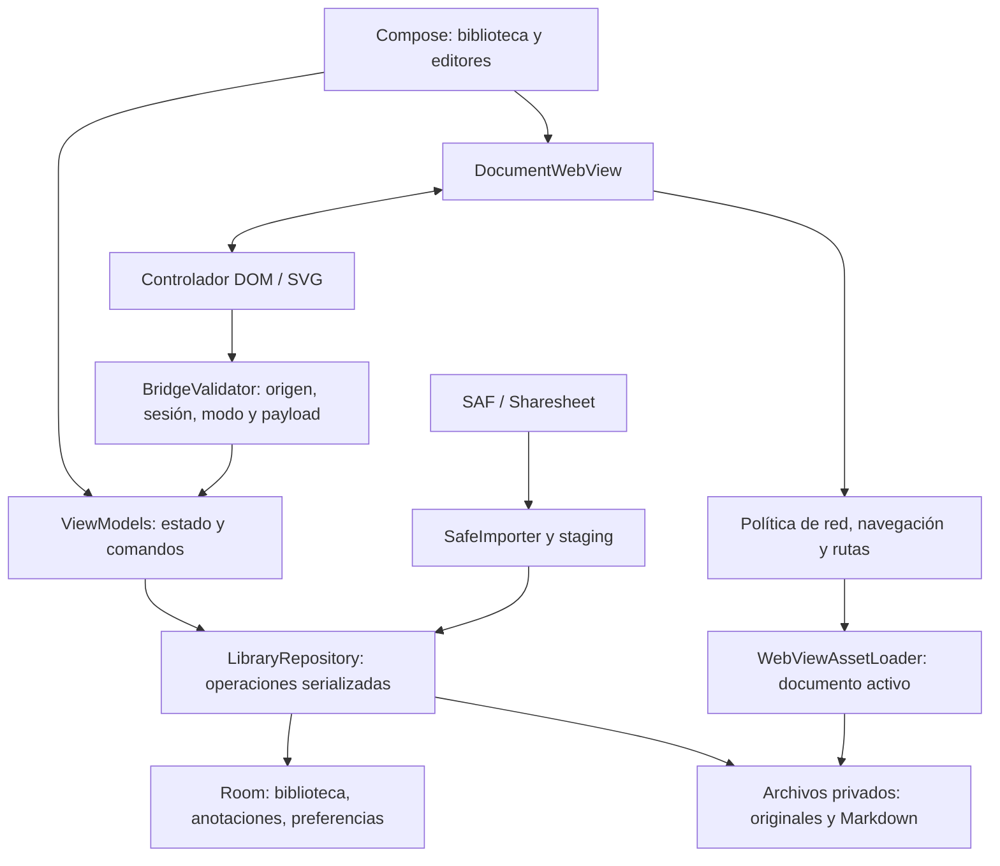

# Arquitectura de Hyper-Marker V1

Estado: implementación nativa en un módulo Gradle `app`. Esta guía describe el código actual; la [especificación original](Interactive_Notes_Android_Agent_Design.md) gobierna el alcance funcional. Versiones en [docs/dependencies.md](docs/dependencies.md); resultados en [docs/validation.md](docs/validation.md).

## Responsabilidades

```text
app/src/main/java/com/hypermarker/
  MainActivity.kt           Entrada, intents compartidos y selección de pantalla
  library/                  Biblioteca Compose, operaciones y licencias
  storage/                  Room, repositorio y SafeImporter
  viewer/                   WebView, ReaderViewModel, cromo de cristal, cruceta y acciones
  markdown/                 Fuente/Visual, barra de formato, política de round-trip y guardado
  flow/                     Flow Dots: canvas, gestos, reglas puras del grafo y cámara
  bridge/                   Validación del protocolo de eventos
  security/                 Rutas e invariantes de jerarquía
app/src/main/assets/
  annotation/controller.js  Hit testing, resaltado, marcadores, SVG y gestos
  security/                 Bootstrap offline previo a scripts del documento
  editor/                   Milkdown local compilado desde web/src/
  licenses/                 Avisos y textos de terceros distribuidos con el APK
```

Se usan Compose, ViewModels y corrutinas. La UI solicita operaciones al repositorio; éste serializa mutaciones en un mutex sobre `Dispatchers.IO` y coordina Room/archivos. El controlador DOM se encarga de geometría y propone eventos; Android valida, muestra editores y decide qué persistir. No hay servidor remoto ni backend.



## Datos y persistencia

Los esquemas Room se exportan en `app/schemas/com.hypermarker.storage.LibraryDatabase/` (v1 y v2). No se usa migración destructiva: `LibraryDatabase.MIGRATION_1_2` crea las tablas de Flow Dots con el SQL del esquema exportado y no toca los datos previos; cada cambio de esquema futuro necesita su propia migración explícita.

| Entidad real | Datos | Invariantes |
| --- | --- | --- |
| Folder | id, parentId?, name, createdAt | FK de padre con cascada; movimientos sin ciclos ni destinos inexistentes. |
| Document | id, folderId?, title, type, entryPath?, networkAllowed, revision, createdAt, updatedAt | UUID independiente del nombre; tipo HTML/MARKDOWN; red inicialmente false. |
| Annotation | id, documentId, kind, pageKey, payload, schemaVersion | PIN/STROKE/TEXT; FK al documento; payload JSON v1 validado y separado del HTML. TEXT guarda ancla, texto original completo y sustitución. |
| ViewerPreference | documentId, zoom, scrollY, speed, direction, pagePath? | Preferencia por documento, sin reanudar autoscroll por sorpresa. |
| FlowNode | id, documentId, title, body, x, y, collapsed, createdAt, updatedAt, deletedAt? | Punto de un documento `FLOW`; coordenadas de mundo en dp; título o cuerpo no vacío; borrado lógico (tombstone) para sincronización futura. |
| FlowEdge | id, documentId, fromId, toId, createdAt, updatedAt, deletedAt? | Conexión dirigida padre → hijo; sin duplicados, autoconexiones ni ciclos (validado en el repositorio). |

Las anclas se embeben en el payload PIN; no hay tabla Anchor separada. El Markdown autoritativo reside en un archivo `.md`, no en una segunda copia editable en Room. Esta concreción mantiene el modelo indicativo del diseño sin duplicar autoridades.

```text
filesDir/documents/<UUID>/original/<rutas del proyecto>
filesDir/documents/<UUID>/markdown/source.md
filesDir/imports/<UUID>/original/<contenido en staging>
```

Importar: copiar → validar → resolver entrada → renombrar staging al destino privado → confirmar Room. Sólo después se publica el documento. Si falla la confirmación se compensan archivos. Al iniciar el proceso, una recuperación serializada limpia staging y directorios no referenciados; no vuelve a ejecutarse sobre importaciones activas del mismo proceso. Un cierre entre rename y commit deja un huérfano limpiable, nunca un documento parcial visible.

Markdown usa `AtomicFile`; los guardados se ordenan por revisión en el ViewModel y se serializan en el repositorio. El archivo es la autoridad si una interrupción ocurre antes de actualizar timestamps/revisión de Room. Autosave tras aproximadamente 500 ms de inactividad, guardado al pausar y guardado explícito antes de salir. Una edición aún no guardada puede perderse por muerte abrupta del proceso.

Duplicar crea nuevos UUID y copias privadas de archivos/anotaciones; la copia empieza sin permiso de red. Las carpetas y sus descendientes se duplican dentro de una transacción de metadatos con limpieza compensatoria de archivos. Eliminar exige confirmación en UI; Room borra en cascada y la limpieza de archivos puede completarse en el siguiente arranque si se interrumpe.

## Importación

`SafeImporter` acepta streams de SAF/Compartir y árboles `DocumentFile`. ZIP usa Commons Compress para inspeccionar modo Unix y rechazar symlinks/entradas especiales. Se comprueban rutas canónicas, colisiones, bytes reales, cantidad, profundidad, ratio y CRC. Ningún URI temporal queda como única copia.

Preferir `index.html` raíz, luego un index inequívoco en directorio envolvente, luego un HTML único. Ante múltiples candidatos se muestra selector. Un HTML suelto no aporta recursos vecinos automáticamente: importar la carpeta, ZIP o varios recursos compartidos cuando corresponda.

Los valores de límites están en `ImportLimits` y [security.md](docs/security.md). Los tests pueden inyectar límites pequeños para no crear archivos enormes.

## Lector y permisos

Cada documento se sirve desde una URL virtual `https://d<UUID>.hypermarker.invalid`. Un `WebViewAssetLoader` con `PathHandler` sólo abre su raíz `original/`. Rutas locales rechazadas nunca caen a filesystem o red. El editor usa un origen HTTPS propio (`editor.hypermarker.invalid`) y sólo assets del APK.

El lector deshabilita file/content URL access, accesos universales, cookies, popups, geolocalización y permisos web automáticos. La red permanece OFFLINE salvo autorización explícita por documento. Se combinan intercepción nativa, `blockNetworkLoads` y CSP en respuestas locales; un bootstrap offline se instala mediante `DOCUMENT_START_SCRIPT` antes de los scripts importados para restringir canales que no controla CSP por sí sola. Se requiere un proveedor WebView actualizado para JavaScript/anotaciones seguras. Workers y service workers están bloqueados incluso con red permitida.

Permitir red autoriza recursos HTTPS/WSS, no navegación principal externa ni acceso a otras bibliotecas. Revocar recrea WebView con nueva política y destruye el anterior. La CSP aplica `sandbox allow-scripts` sin `allow-same-origin`: cada frame del contenido tiene origen opaco, incluso si la URL es local. Esto impide recuperar constructores de red desde un iframe vacío. Las respuestas locales incluyen CORS para módulos ES/fetch relativos. Cookies e IndexedDB no están disponibles; un shim de `localStorage`/`sessionStorage` mantiene las APIs comunes sólo en memoria por sesión. Esta limitación se aplica también al permitir red, para no convertir ese permiso en una concesión implícita de almacenamiento. No hay pretensión de sandbox perfecto: los límites y pruebas están en [security.md](docs/security.md).

Consola mediante `WebChromeClient` y callbacks de errores HTTP/recursos, buffer de hasta 300 entradas acotadas. Autoscroll se ejecuta con RAF; touch, cambio de modo y pausa del lifecycle lo detienen. Back usa historial antes de salir. Zoom, scroll y página se restauran sin reanudar autoscroll. Una caída del renderer deja los datos durables fuera de WebView y permite recargar.

## Protocolo de anotaciones v1

Android instala `HyperMarkerBridge` con `WebViewCompat.addWebMessageListener`. El transporte usa `*` porque los documentos aislados tienen origen opaco; esto no concede acceso a Android a cualquier origen. El host exige frame principal, URL HTTPS del documento activo, sesión/revisión, modo y payload válidos. Los mensajes de subframes y páginas externas se descartan. El editor de confianza conserva su restricción de origen exacto. El controlador envía:

```json
{
  "protocolVersion": 1,
  "sessionId": "opaque-viewer-session",
  "documentId": "UUID",
  "revision": 1,
  "requestId": "1",
  "type": "target.selected",
  "payload": {"pageKey": "/index.html", "anchor": {}}
}
```

Eventos actuales: `controller.ready`, `tap`, `hold`, `longpress`, `target.selected`, `annotation.activated`, `anchor.unresolved`, `stroke.completed`, `stroke.erase`. `tap` alterna el cromo (en Ver sólo fuera de contenido interactivo), `hold` produce la vibración háptica al activarse la pulsación prolongada, `longpress` (Ver/Dibujar) abre la cruceta con el rectángulo del bloque mantenido y `target.selected` (Editar) incluye además el texto editable acotado y los ids de pines/textos relacionados con el elemento. `BridgeValidator` verifica tamaño, versión, sesión, revisión, requestId, frecuencia, modo, tipo y geometría. El host compara `pageKey` con la navegación activa y vuelve a validar pertenencia antes de modificar datos. La sesión cambia en navegaciones completas.

Android → controlador: invocación de funciones acotadas `init(config)` y `command(type,payload)` mediante `evaluateJavascript` con JSON serializado. Comandos: `mode`, `annotations`, `tool`, `cancel`, `inspect`, `selectTarget`, `autoscroll`. No se expone una interfaz nativa de eval, archivos, procesos o permisos. La geometría se actualiza en JS sin enviar cada píxel a Android.

La página puede compartir contexto con el controlador: un sessionId no es autenticación secreta frente a ella. Incluso los mensajes del origen correcto son no confiables. Guardar un pin requiere el editor nativo y contenido significativo. El texto se transporta como datos; los marcadores usan `textContent`, no interpolación HTML.

## Interfaz del lector

Sin cromo permanente. Un `tap` muestra u oculta un botón de opciones arriba a la derecha (con Deshacer/Rehacer en Editar y Dibujar). Con ruedas activas hay tres botones de modo abajo: Ver, Editar y Dibujar. Al desactivarlas desde la primera opción del menú, esos botones se sustituyen por Autoscroll, Pin y Dibujar. Pin queda marcado hasta el siguiente toque de elemento, que abre el editor de nota; Dibujar entra con pluma básica. La preferencia es global y se guarda en `reader_cross`. En Ver el cromo se oculta tras unos 5 s sin uso. Los botones son "cristal" translúcido: relleno degradado, borde gris oscuro semitransparente y halo. Compose no puede desenfocar el WebView situado debajo, así que no hay desenfoque real; para mantener contraste, `DocumentWebView.luminance` dibuja una copia reducida (8 %) del WebView en software y elige tono claro u oscuro para cada zona.

Con ruedas activas, mantener presionado abre la cruceta de cuatro acciones del modo activo en el punto soltado. `ReaderAction` define el conjunto de acciones por modo; `CrossLayout` asigna cuatro posiciones (arriba, derecha, abajo, izquierda) e intercambia acciones, y `CrossLayoutStore` lo persiste en `SharedPreferences` (`reader_cross`), igual para todos los documentos. En Ver, Configuración ocupa el lugar de Zoom original; las disposiciones guardadas se migran al leerlas y Zoom original permanece en el menú. Las acciones no asignadas aparecen en el menú con un botón de intercambio; mantener una opción de la cruceta abre su selector. Las acciones de elemento invocadas desde el menú usan la lista accesible de elementos y se ejecutan sobre la selección resultante.

`zoomToFit` calcula la escala que encaja el rectángulo completo del bloque (CSS px de documento) en la vista, aplica `zoomBy`, espera a que `onScaleChanged` se estabilice y centra el bloque con `scrollTo`. `resetZoom` aplica el factor mínimo, que WebView limita a la escala original de la página.

## Pines, páginas y dibujos

Estados en Editar: pendiente → selección activa (resaltado vivo, deslizar cambia de objetivo) → soltar: selección retenida y cruceta → acción (Nota pin abre el editor) o cancelación, que retira el resaltado. Reanclar omite la cruceta y abre el editor directamente. El umbral usa al menos 500 ms y respeta el timeout largo configurado en Android. Movimiento previo significativo, multitouch, cancelación y salida de modo limpian el estado. Mantener activo y deslizar actualiza el elemento bajo `elementsFromPoint`; soltar quita el resaltado y propone el editor. Existe selección accesible por lista sin long-press.

El ancla guarda estrategia DOM/SURFACE, selector único o path, tag, texto contextual, ancestros, coordenadas normalizadas, posición aproximada, dimensiones y precisión. Reabrir resuelve selector único con tag/texto compatibles; ambigüedad, ausencia o cambio de identidad producen Unanchored. No hay reconciliación difusa V1.1. Canvas/SVG sin contenido seleccionable e iframes son superficies. Regiones grandes/transformadas se explican como rectángulos de límites.

`pageKey` contiene pathname y query; conserva hash sólo si empieza por `#/` o `#!` para rutas SPA. Un hash ordinario de sección no crea otra página. Pines y trazos se filtran por esa clave. Inspeccionar un pin de otra página navega a su página privada antes de resaltarlo.

Las sustituciones de texto (`TEXT`) resuelven el elemento con la misma regla de ancla y sólo se aplican si `textContent` coincide exactamente con el original guardado; entonces se asigna el texto nuevo con `textContent` y se conservan en memoria los nodos originales para restaurarlos sin recargar. Un contenido distinto del original o de la sustitución se marca como sin coincidencia. Los pines del mismo elemento siguen resolviéndose porque la huella de texto usa el original. Nunca se editan inputs, textareas, selects ni superficies. Es un adelanto de V1.1 solicitado por el propietario; la reconciliación avanzada sigue pendiente.

En Dibujar, mantener sin moverse antes del umbral descarta el trazo iniciado y abre la cruceta; un toque breve con el dedo alterna el cromo sin dejar punto, y un toque con lápiz sí dibuja un punto. Los dibujos usan coordenadas de página CSS con viewport/escala, SVG y herramientas pen/highlighter/eraser. Se persiste un evento por trazo completo; clear exige confirmación. Scroll/resize/zoom/mutaciones agrupan recálculos por RAF. Las capas generales no capturan toques en View; los marcadores mantienen su interacción explícita. Reflujo puede desalinear trazos y está comunicado.

Undo/redo nativo conserva snapshots de sesión para creación, borrado, edición y movimiento; el estado final se guarda en Room. Los guardados de anotaciones se ordenan, y salir espera el último; un error conserva el estado en memoria y permite reintentar. Hay límites por payload, cantidad y total por documento.

## Markdown y decisiones finales

La pantalla es una hoja blanca, u oscura opcional (`SheetStyleStore`, junto con el tipo de letra Sans/Serif/Mono). Una barra superior monocroma comparte comandos entre modos: en Fuente, `MarkdownFormatter` transforma la selección del `TextFieldValue` (envolver, quitar el formato si ya existe, prefijar líneas, insertar bloques); en Visual se llama a `window.editorCommand`, que ejecuta comandos de Milkdown sobre la selección de ProseMirror. La barra flotante propia de Crepe está desactivada. Fuente usa un editor Compose. Visual usa Milkdown Crepe empaquetado localmente, sin red, CDN, estadísticas ni código HTML importado ejecutable. Cambiar de Visual a Source o salir consulta el Markdown actual antes de guardar. `MarkdownPolicy` protege construcciones no preservables y mantiene su fuente intacta; el subconjunto ordinario y las tablas GFM bien formadas (cabecera, delimitador y columnas consistentes, con contenido de celdas también revisado) sí permiten edición visual real. Visual normaliza el relleno de las tablas y el marcador de lista.

Se confirmaron Kotlin/Compose + Room + archivos privados; módulo único; anclas en JSON v1; Markdown en archivo; host por documento; protocolo acotado; historial de sesión y SDK 26/36. Las versiones están fijadas y sus licencias en el APK. Permanecen decisiones de producto posteriores: licencia del código propio, distribución de producción, V1.1 y exportación/backup. Los overrides de texto se adelantaron de V1.1 por solicitud explícita del propietario; la reconciliación avanzada de anclas sigue pendiente.

## Flow Dots (prototipo F1+F3)

Funcionalidad autorizada aparte de la especificación; decisiones y fases en [docs/proposals/flow-dots.md](docs/proposals/flow-dots.md). `MainActivity` abre `FlowScreen` para documentos `FLOW`. `FlowViewModel` observa puntos y conexiones activos en Room y guarda la cámara como estado de sesión. Las mutaciones pasan por `LibraryRepository` (mismo mutex): crear, editar, mover, plegar, conectar y borrar. Borrar un punto marca con tombstone el punto y sus conexiones en una transacción; duplicar copia el grafo con identidades nuevas; borrar el documento elimina las filas en cascada.

`FlowGraph` contiene la lógica pura: detección de ciclos, nodos ocultos por plegado (alcanzables sólo a través de un nodo plegado; un hijo con otro padre visible sigue visible; ciclos sin raíz llegados de fuera se muestran) y búsqueda del punto más cercano. `FlowCamera` convierte entre pantalla y mundo, hace zoom sobre un punto fijo y encuadra.

Todo se dibuja en un único `Canvas` (rejilla, curvas con flecha, puntos, títulos con `TextMeasurer`), descartando lo que queda fuera de la vista; los títulos se ocultan con zoom menor a 0,45. Gestos, en un solo `awaitEachGesture`: toque en vacío abre el editor de un punto nuevo (sólo se crea al guardar); toque en punto abre la tarjeta provisional; mantener al menos 500 ms (o el timeout largo del sistema) sobre un punto produce háptica y, al soltar sin moverse, pliega/despliega; si se desliza, extiende una conexión que resalta el destino (rojo si es inválido) y al soltar conecta o cancela; arrastrar en vacío desplaza y dos dedos hacen zoom. En Reordenar arrastrar un punto lo mueve y se guarda al soltar. La tarjeta ofrece editar, plegar, «Conectar con…» y quitar conexiones como alternativa sin gesto prolongado. El canvas no expone cada punto a TalkBack todavía.

## GitHub Sync (implementación incremental)

Función adicional aprobada en [docs/proposals/github-sync.md](docs/proposals/github-sync.md), independiente de Flow Dots. `HyperMarkerApplication` comparte un `GitHubApiClient`, `ResourceGovernor` y `GitHubSyncEngine` entre biblioteca y `GitHubSyncWorker`; ninguna pantalla ni worker abre GitHub directamente. `GitHubAuthStore` protege el PAT con AES-GCM y Android Keystore. El transporte acepta únicamente `https://api.github.com`, sin redirecciones, y contabiliza petición y bytes antes de entregar el cuerpo al motor.

Room v3 añade `remote_folders` y `remote_entries` mediante migración v2→v3. La identidad remota incluye repo ID, rama y ruta; cambiar de rama crea otra carpeta. HTML remoto conserva un documento y anclas de página estables mientras `remote-current` apunta a la generación privada publicada; Markdown remoto mantiene ID, fuente versionada y tipo de solo lectura. Desvincular convierte los archivos al formato local conservando IDs y anotaciones. El paquete HTML se valida en staging y sólo después se confirma el nuevo SHA en Room. Ante fallo previo, el snapshot anterior sigue accesible. Si la publicación del puntero de archivos falla tras la transacción de Room, `LibraryRepository.recover` lo reconstruye al iniciar.

El sondeo periódico usa una sola `PeriodicWorkRequest` global, 60 min como mínimo, con red no medida, batería y almacenamiento suficientes. Entrar en carpeta intenta actualizar después de 10 min bajo red no medida y batería suficiente. Abrir un documento no activa red del WebView: su permiso sigue siendo individual y OFFLINE por defecto. La telemetría local registra cuerpos HTTP y estado; sus límites propios son distintos de `X-RateLimit-*` de GitHub. Detalles, evidencias y pendientes están en la propuesta y en [progress.md](progress.md).

### Cierre técnico de GitHub Sync (2026-10-27)

El mutex de sincronización coalesce las peticiones simultáneas; la publicación, recuperación, copia local y desvinculación comparten además el mutex del repositorio. Desconectar cancela el trabajo activo y desactiva auto-sync en las fuentes persistidas. Los repositorios públicos también pueden actualizarse periódicamente sin PAT; usan topes inferiores (20 peticiones/h y 100/24 h).

Cada `DocumentWebView` captura la raíz de su generación al crearse. Publicar otra generación no mezcla assets en un renderer abierto; los HTML antiguos se limpian en el próximo arranque, bajo el mismo mutex y dentro del cap de disco. La recuperación repara el puntero HTML desde el commit confirmado en Room y elimina versiones Markdown sin referencia y staging huérfano. Las copias retiradas conservan su última generación hasta su limpieza explícita o desvinculación.

El presupuesto guarda reloj civil, tiempo monotónico y contador de arranque: bloquea retrocesos y saltos incompatibles dentro del mismo arranque. Una configuración corrupta falla cerrada y su reparación explícita mantiene pausa y una espera conservadora de 24 h. Las respuestas se acotan al saldo de bytes antes de leer y se cuentan también las lecturas parciales. Un 401 suspende el uso de la credencial hasta una comprobación de reconexión exitosa.

El panel de consumo presenta ventanas 1 h/24 h/30 días por fuente y total, almacenamiento, estados HTTP y ejecuciones recientes con duración, CPU del proceso y condiciones de batería; la CPU es un indicador indirecto. El detalle se limita a 500 peticiones y 500 ejecuciones, con agregados diarios HTTP hasta 30 días. Exportar usa SAF y sustituye las identidades de fuentes por ordinales, sin nombres de repositorio, paths, cuerpos ni credenciales. La selección de repo/rama sigue `Link` con host/ruta comprobados y un cap explícito de cinco páginas; se conserva entrada manual como alternativa.
