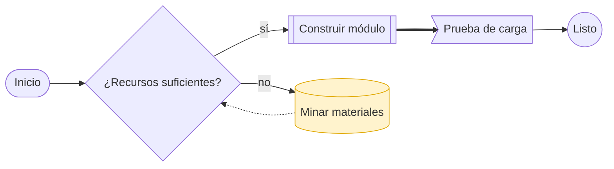
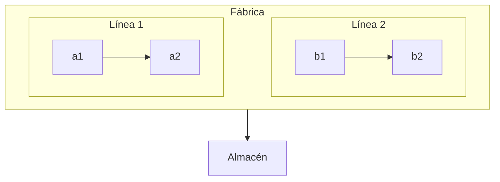
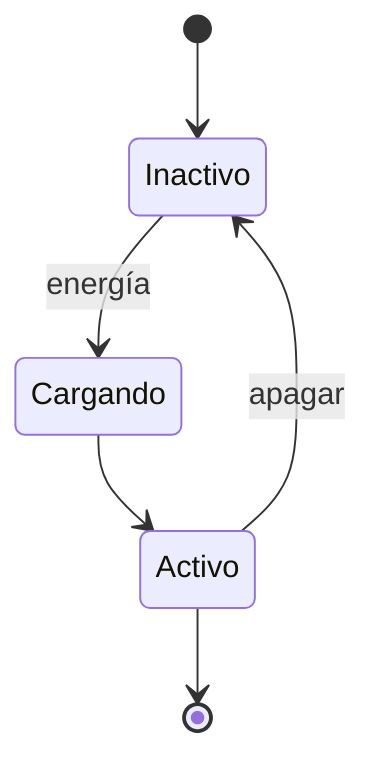
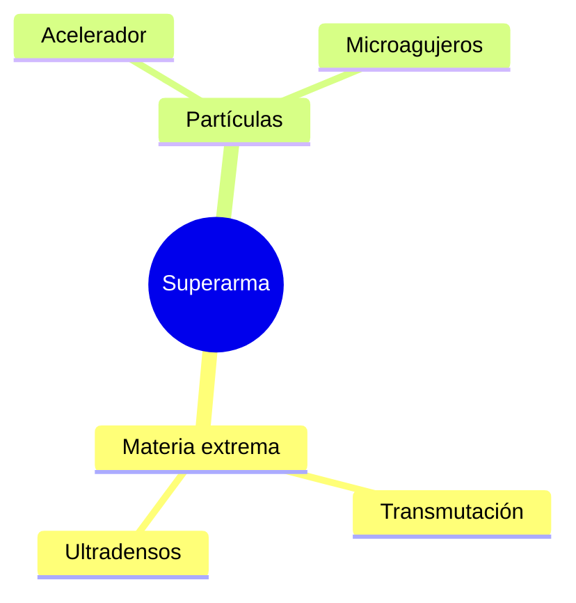

# Diagramas Mermaid: leer, guardar, convertir en Flow y exportar

Estado: **pedido explícito del propietario el 2026-11-17/18** («quiero añadir la funcionalidad de leer mermaid diagrams… convertirlos en flows o añadir el diagrama a un flow existente… al exportarlo no se linkearía sino que se copiaría»; después: «permitir [exportar] el código a SVG y PNG de alta resolución»). Función nueva fuera de la [especificación original](../../Interactive_Notes_Android_Agent_Design.md), que no se modifica. Primera versión implementada; la aceptación en dispositivo está pendiente.

Referencia visual del propietario: su diagrama «Generador gravitacional / Superarma» exportado desde Mermaid con el aspecto *neo*. El código está en [`fixtures/mermaid/generador-gravitacional.mmd`](../../fixtures/mermaid/generador-gravitacional.mmd).

## Comportamiento

- **Nuevo tipo de documento `MERMAID`.** Se crea desde «Nuevo → Diagrama» (con una plantilla de tres pasos) o se importa un archivo `.mmd`/`.mermaid` desde «Archivos» o «Compartir». El código es la autoridad y se guarda solo (unos 500 ms, al pausar y al salir) en `documents/<id>/mermaid/source.mmd` con `AtomicFile`. Admite hasta 300 000 caracteres, el mismo `maxTextSize` del visor. No hay migración de Room: `type` ya es texto.
- **Pantalla con dos pestañas.** *Diagrama* dibuja el código con Mermaid local, admite zoom con dos dedos y empieza ajustado al ancho. *Código* es un editor monoespaciado con deshacer y rehacer. Un error de sintaxis muestra el mensaje del parser y deja visible, atenuado, el último diagrama válido. La miniatura de la biblioteca es la captura del visor al cerrar, como en HTML.
- **Aspecto.** `theme: "redux-color"`, `look: "neo"` y la fuente Recursive (la misma de la referencia), incrustada. Las etiquetas son SVG puro (`htmlLabels: false`), con `wrappingWidth` de 180 px para no cortar palabras como «INFRAESTRUCTURA».
- **Flow nuevo.** Crea un Flow con el mismo título en la carpeta del diagrama y copia cada nodo como punto. La primera línea de la etiqueta es el título; el resto es el cuerpo, más «Grupo: …» si el nodo pertenece a un subgrafo. Cada conexión pasa a ser una conexión del Flow. Las posiciones son las del layout de Mermaid (1 px = 1 dp de mundo) y los puntos de cada subgrafo llevan su color.
- **Añadir a un Flow.** Una hoja lista los Flows existentes. El diagrama se copia a la derecha del contenido actual (360 dp de separación, alineado arriba) con un punto amarillo de cabecera que lleva el título del diagrama y la fecha. Así se comparan varios diagramas en el mismo lienzo.
- **Copia, nunca enlace.** El Flow no guarda relación ni referencia al documento Mermaid. Editar o borrar el diagrama no cambia el Flow, y viceversa.
- **Exportar.** *SVG*: archivo autónomo con tamaño explícito, fondo blanco y la fuente incrustada (se ve igual fuera de la app y se abre en editores sin soporte de `foreignObject`). *PNG*: 2×, 3× o 4× con las dimensiones visibles antes de elegir. Por memoria se limita a 8192 px por lado y 40 MP, reduciendo proporcionalmente. El destino se elige con SAF; no se piden permisos.

## Qué se adapta (y cómo se avisa)

Desde Room v5 (2026-11-18) las conexiones de Flow admiten texto y **retornos** (bucles visuales), así que la copia conserva casi todo:

| Mermaid | En el Flow |
| --- | --- |
| Etiqueta de flecha (`A -- sí --> B`, `A -->|sí| B`, `X --> Y: texto`) | Texto en medio de la conexión. |
| Arista que cerraría un ciclo (p. ej. `Activo --> Inactivo` en una máquina de estados) | Conexión de **retorno**: punteada, en lila, fuera del plegado y de las raíces. |
| Arista repetida | Una sola conexión; si traían textos distintos se unen con « / ». |
| Autoconexión | Se anota en el punto («↻ Se conecta consigo mismo»): Flow no dibuja autoconexiones. |
| Enlace invisible `~~~` | Se ignora: sólo sirve para el layout. |
| Subgrafo o estado compuesto usado como extremo de una flecha | Punto con el título del grupo. |
| Pseudoestados `[*]` | Puntos «● Inicio» y «◉ Fin». |
| Ramas de un mapa mental | Color de la rama en cada punto. |
| Forma del nodo, estilos `classDef`/`style`, iconos | No se copian; los puntos de Flow no tienen forma. |

Al terminar, un diálogo resume puntos, conexiones, retornos y adaptaciones, con «Abrir Flow» (Atrás vuelve al diagrama). Las posiciones salen del layout de Mermaid; si el layout es compacto (estados, mapas mentales) se amplía hasta una separación típica de 150 dp entre vecinos (máximo ×4) para que los títulos no se tapen.

**Se convierten flowcharts, diagramas de estados y mapas mentales.** Los demás tipos (secuencia, clases, ER, Gantt…) se dibujan, guardan y exportan; la conversión responde que ese tipo no se convierte.

## Implementación

- `web/src/mermaid.html` + `web/src/mermaid-viewer.js` se construyen en `app/src/main/assets/mermaid/`. `mermaid.min.js` 12.3.0 se copia sin cambios desde npm, y el visor propio lleva la fuente Recursive como `data:` (`@fontsource/recursive` 5.3.0, OFL).
- Funciones expuestas al host: `renderDiagram(source, session)`, `requestGraph(source, id)` y `exportDiagram(source, id, 'svg'|'png', escala)`. Las respuestas salen por `MermaidBridge` en fragmentos de 400 000 caracteres.
- La estructura del grafo sale del **propio parser de Mermaid** (`mermaidAPI.getDiagramFromText` → `db.getVertices/getEdges/getSubGraphs`), no de una gramática paralela, y las posiciones del SVG ya dibujado. Así se acepta exactamente la misma sintaxis que se ve.
- `MermaidFlow` (Kotlin, puro) valida el JSON y planifica la copia. `LibraryRepository.copyMermaidToFlow` la escribe en una transacción bajo el mutex: todo o nada, con límites de 5000 puntos y 20 000 conexiones por Flow.
- `ChunkAssembler` exige fragmentos en orden, un total estable y un máximo por tipo (SVG 24 M, PNG 96 M caracteres base64, grafo 16 M).
- Los puntos sin foto ahora se pintan con `ringColor` si lo tienen (antes sólo el anillo de los puntos con foto lo usaba). Efecto en datos existentes: un punto al que se le quitó la foto conserva el color de anillo que el usuario había elegido y ahora se pinta con él en lugar de menta.

## Seguridad

- El código Mermaid importado no es de confianza. El visor usa `securityLevel: 'strict'` (DOMPurify en etiquetas, `click` sin efecto) y Mermaid impide cambiar `securityLevel` desde directivas `%%{init}%%`.
- WebView propio: origen `https://mermaid.hypermarker.invalid`, sólo assets `/mermaid/…` del APK, `blockNetworkLoads`, sin archivos, contenido, almacenamiento DOM, permisos ni navegación. CSP `default-src 'none'`, `script-src 'self'`, `connect-src 'none'`, imágenes y fuentes sólo `data:`/`blob:`.
- El bridge exige frame principal, origen exacto, sesión aleatoria y mensajes ≤ 1 MB. Aun así, su contenido se trata como no confiable: textos recortados, coordenadas finitas, límites de cantidad y escritura sólo en el destino elegido por el usuario.
- La prueba web `hostile labels…` comprueba que ``, `<script>`, `javascript:`, `click … call` y una directiva `init` con `securityLevel: loose` no ejecutan código ni cargan recursos remotos.

## Límites conocidos

- APK +5,5 MB sin comprimir por `mermaid.min.js` (incluye todos los tipos de diagrama).
- El zoom es el del WebView (pellizco); no hay panel de minimapa ni ajuste automático en diagramas muy anchos.
- El editor de código no resalta sintaxis ni autocompleta. Los errores muestran el mensaje del parser, sin marcar la línea en el editor.
- En notas Markdown, la vista previa de bloques mermaid sólo existe en Visual; en Fuente se ve el código.
- No se probó todavía en dispositivo: WebView de Android real, zoom táctil, SAF, captura de miniatura ni rendimiento con diagramas de cientos de nodos.

## Decisiones del propietario (2026-11-18)

1. **Bloques ` ```mermaid ` en notas Markdown: sí.** Implementado (ver abajo).
2. **Estados y mapas mentales → Flow:** primero quedó pendiente con evaluación; el mismo día el propietario pidió implementarlo. Implementado.
3. **Flow → Mermaid: sí**, sobre todo para exportar SVG/PNG, compartir la idea general de un sistema o imprimirlo para anotar. Implementado (ver abajo).
4. **Referencias:** entregadas en SVG y PNG. Los SVG están en [`docs/design/mermaid/`](../design/mermaid/) y los códigos en `fixtures/mermaid/muestra-*.mmd`.

## Bloques mermaid dentro de notas Markdown

- En **Visual**, cada bloque ` ```mermaid ` (o ` ```mmd `) se muestra como diagrama con el mismo estilo del visor. «Editar código» despliega el código del bloque y «Solo diagrama» lo vuelve a ocultar (vista previa de bloques de código de Milkdown). **Fuente** sigue mostrando el texto tal cual; el Markdown guardado no cambia.
- Mermaid (5,5 MB) se carga **sólo** si la nota tiene un bloque de ese tipo. Usa el mismo asset y la misma configuración que el visor (`web/src/mermaid-config.js`).
- «Abrir como diagrama», bajo cada diagrama, guarda la nota y crea un documento Mermaid **copiado** del bloque («Diagrama · <nota>», misma carpeta). Desde él se convierte a Flow o se exporta. Atrás vuelve a la nota. En la vista de solo lectura de GitHub el botón no aparece.
- Un bloque con errores muestra el mensaje del parser en lugar del diagrama. Milkdown sanea la vista previa con DOMPurify además del modo `strict` de Mermaid; el botón se atiende por delegación, porque el saneado elimina manejadores.

## Flow → Mermaid

- Botón de diagrama en la cabecera del Flow → «Crear diagrama Mermaid». Crea un documento Mermaid **copiado** del Flow, en su carpeta, y lo abre. El Flow no cambia y no queda enlazado.
- Cada punto es una caja con el título y hasta dos líneas de su nota (80 caracteres por línea). El orden es de arriba abajo y de izquierda a derecha. Mermaid recalcula la disposición: las posiciones manuales del Flow no se conservan.
- Deshace las anotaciones de la conversión Mermaid→Flow para que ida y vuelta no pierdan estructura: «Grupo: X» vuelve a ser subgrafo; «← Padre: texto» vuelve a ser la etiqueta de esa flecha; «→ Destino (conexión omitida: crearía un ciclo)» vuelve como flecha punteada; «↻ Se conecta consigo mismo» vuelve como autoconexión. Una anotación que no corresponde a ningún punto queda como texto.
- Los puntos con color y sin grupo conservan el color en el borde (`style … stroke`). Fotos y relaciones no se copian.
- Límite: 4000 conexiones (el `maxEdges` del visor). El texto se escapa con entidades de Mermaid (`#quot;`, `#35;`, `#124;`…).
- Corrección encontrada al probarlo: el parser de Mermaid guarda esas entidades con marcadores internos (`fl°…¶ß`). El extractor ahora los devuelve como entidades HTML y Kotlin las decodifica, así que una etiqueta con comillas o `#` ya no llega rota a Flow.

## Referencias visuales del propietario: hallazgos

Las cuatro muestras se dibujan como en las referencias: formas (estadio, rombo, subrutina, cilindro, bandera, círculo), flechas gruesa y punteada, `classDef`, subgrafos anidados con colores distintos, estados con inicio y fin, y mapa mental con ramas de color. Diferencias corregidas:

- **Estados con texto alineado a la izquierda.** Con etiquetas SVG, Mermaid reserva el ancho mínimo del estado pero dibuja el texto desde la izquierda. `polish()` recentra cada etiqueta en su caja (visor y notas).
- **Fondo de las etiquetas de flecha.** En estados quedaba blanco al 50 % (una regla CSS más específica); ahora es gris sólido `#cccccc`, como en las referencias.

Diferencia aceptada: las referencias usan etiquetas HTML y parten «¿Recursos suficientes?» o «Construir módulo» en dos líneas. Aquí, con `wrappingWidth` 180, caben en una. Se mantienen las etiquetas SVG porque el PNG las necesita (las HTML contaminan el canvas) y el SVG exportado se abre en más editores.

## Estados y mapas mentales → Flow (implementado 2026-11-18)

Comprobado en el parser incluido: ambos tipos exponen `db.getData()` con la misma forma (nodos con `label`, `parentId` e `isGroup`; aristas con `start`, `end` y `label`). La extracción sería genérica y reutilizaría `MermaidFlow.plan`.

| Tipo | Complejidad | Utilidad inmediata | Comentario |
| --- | --- | --- | --- |
| Mapa mental | Baja (≈ medio día con pruebas) | **Alta** para planear: lluvia de ideas → puntos de Flow para luego relacionar documentos y fotos. | Es un árbol: encaja sin pérdidas en Flow (sin ciclos). Las posiciones radiales de Mermaid se pueden conservar. |
| Estados | Baja–media (≈ 1 día) | Media-baja | Las máquinas de estados suelen ser cíclicas (Activo → Inactivo): varias transiciones quedarían como anotaciones. Hay que traducir los pseudoestados inicio/fin y los estados compuestos (grupos). |

Evaluación previa conservada arriba. Se implementaron ambos con `getData()` y `domId` (posición y color de cada nodo en el SVG). La objeción de los estados desapareció con los retornos de Flow: `Activo → Inactivo` se copia como retorno con su texto «apagar».

## Texto en medio de las flechas de Flow (implementado 2026-11-18)

Evaluación previa (viable, ≈ 1–1,5 días) aprobada por el propietario. Lo implementado sigue ese plan:

- **Datos:** columna `label` en `flow_edges` (Room v5, migración `ALTER TABLE … ADD COLUMN`, sin reescribir filas). Hay que respaldar el S24/Tab antes de instalar, como en v2–v4.
- **Dibujo:** el texto en una píldora en el punto medio de la curva (`FlowCanvas` ya calcula la curva y la flecha). Se oculta por debajo del zoom de detalle, igual que los títulos.
- **Edición:** hoy las flechas no se pueden tocar. Propuesta: tocar cerca del punto medio abre «Texto de la conexión» (editar o quitar). Alternativa accesible en la tarjeta del punto, donde ya se listan las conexiones para quitarlas.
- **Mermaid:** las etiquetas pasarían directamente a la conexión en vez de anotarse en el cuerpo del destino, y Flow → Mermaid las exportaría como `-->|texto|`. Las anotaciones «← A: texto» de copias anteriores se podrían migrar a la etiqueta al editar.
- **Riesgos:** etiquetas largas que tapan puntos (limitar a ~60 caracteres visibles con elipsis) y toques ambiguos entre flecha y punto (los puntos tienen prioridad).
## Muestras para pedir referencias

Para afinar el aspecto con combinaciones que el diagrama de referencia no cubre, sirven las capturas de estos códigos desde el mismo editor que se usó para la referencia:









## Retornos en Flow (bucles visuales, implementado 2026-11-18)

Pedido del propietario: «Flow debería poder aceptar los bucles en el sentido de poder llamar a dots padres desde los hijos. Así es como funcionan las ideas. Aun si dicha feature es solo visual para no romper como funciona el sistema actual».

- Conectar un punto con un antepasado (o con cualquier punto que cerraría un ciclo) ya no se rechaza: se crea una **conexión de retorno** (`flow_edges.loop = 1`). Al arrastrar, el destino se resalta en lila antes de soltar; en «Conectar con…» esos destinos dicen «Retorno».
- Los retornos se dibujan punteados, en lila y arqueados (el arco crece con la distancia, para no cruzar por encima de la cadena). Su texto se coloca en el tramo de la curva más alejado de puntos y otros textos.
- **No cambian el sistema actual:** el árbol padre → hijo, la regla sin ciclos, el plegado («+N»), las raíces y «Conexiones» de un padre funcionan igual que antes, porque sólo usan las conexiones normales. Un retorno sólo se dibuja si sus dos puntos están visibles.
- Si deja de haber camino de vuelta (p. ej. se borra un punto intermedio), las conexiones existentes conservan su tipo; una conexión nueva entre esos puntos sería normal.
- Mermaid ↔ Flow: los ciclos de Mermaid se copian como retornos y Flow → Mermaid los exporta como `-.->`. Las copias anteriores a v5 conservan sus anotaciones «→ … (conexión omitida…)», que Flow → Mermaid sigue entendiendo.
